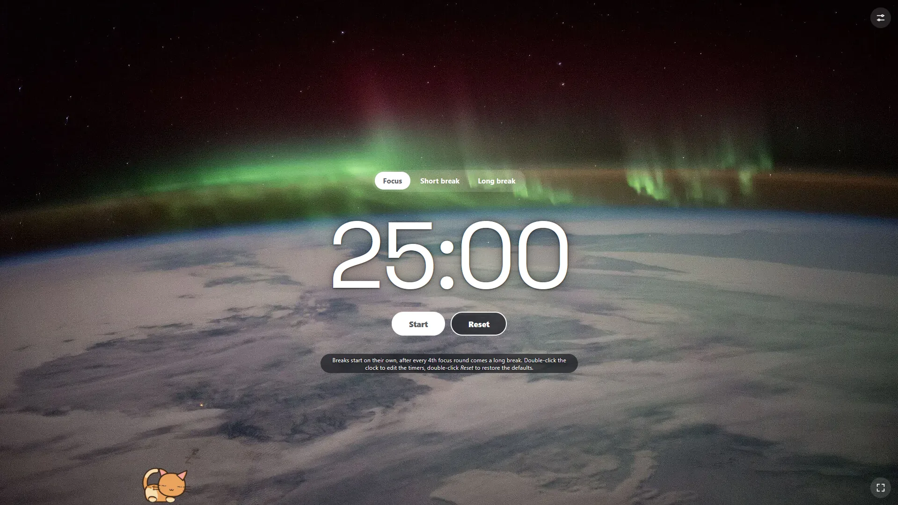

# Focus Timer

A minimal, dependency-free Pomodoro timer that runs entirely in the browser.

## Features

- Automatic focus and break cycling, with a long break every fourth round
- Editable timers via double-click
- Multiple background images with automatic light/dark text contrast
- Multiple alarm sounds
- Settings saved locally in cookies, there is no tracking or ads
- A small cat companion to help in your studies

## License

Code is released under the MIT License. Background images are public domain / CC0, and the Space Grotesk font is under the SIL Open Font License.

## Credits

- Background images: public domain / CC0 from Wikimedia Commons (see `assets/backgrounds/CREDITS.txt`)
- Font: Space Grotesk, self-hosted (see `assets/fonts/OFL.txt`)

## AI disclosure

This was a small ~1 hour project, built with AI assistance while procrastinating for a test instead of studying. Maybe this timer will help you and me study in the future :)
